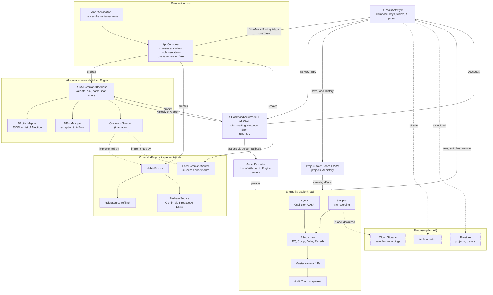

# Архітектура

Додаток складається з інтерфейсу (Compose), аудіорушія (три потоки), AI-сценарію з composition root (`App` / `AppContainer`) та запланованих хмарних сервісів Firebase.

## Схема

## Компоненти

| Компонент | Файл | Роль |
|---|---|---|
| UI | `MainActivity.kt` | `Screen` (головний екран з вкладками Studio / Library), `ScopePanel` (осцилограф, курсор, loop, сітка) |
| Рушій | `Engine.kt` | аудіопотоки, запис, ланцюжок ефектів, master volume, кільцевий буфер осцилографа |
| DSP | `Dsp.kt` | `Synth`, `Sampler`, `Eq`, `Comp`, `Delay`, `Reverb` |
| AI-шар | `Ai.kt` | лише схема дій для моделі (`Ai.SYSTEM`) і тонка обгортка `Ai.apply` (використовується тестами) |
| Use case | `RunAiCommandUseCase.kt` | сценарій «prompt → список дій»: валідація, виклик джерела, парсинг, повертає `Result<AiReply>`; не знає `Engine` |
| ViewModel | `AiCommandViewModel.kt`, `AiUiState.kt` | стани Idle / Loading / Success / Error; `run` ігнорує повторні натискання під час Loading; `retry` повторює останній невдалий запит; дії до `Engine` застосовує колбек екрана (ViewModel не знає `Engine`) |
| Типи AI | `AiAction.kt`, `AiError.kt` | `AiAction` (типізована дія), `AiError` (категорії: InvalidInput, Network, AiUnavailable, InvalidResponse, Unknown), `AiException` |
| Парсинг | `AiActionMapper.kt` | JSON → `List<AiAction>`; чистий парсинг без доступу до `Engine` |
| Виконання | `ActionExecutor.kt` | застосовує `List<AiAction>` до `Engine` тими ж сетерами, що й UI; формує лог |
| Помилки | `AiErrorMapper.kt` | технічний виняток → `AiError`; `CancellationException` не ковтає |
| Джерела команд | `CommandSource.kt` | інтерфейс `CommandSource` (повертає `CommandReply(json, source)`), `RulesSource`, `FirebaseSource`, `HybridSource`; типи Firebase SDK не виходять за межі `FirebaseSource` |
| Fake | `FakeCommandSource.kt` | друга реалізація інтерфейсу з режимами SUCCESS, NETWORK_ERROR, UNAVAILABLE, INVALID_JSON; без мережі й ключів |
| Composition root | `App.kt`, `AppContainer.kt` | `App` створює `AppContainer` один раз; контейнер єдине місце, де обираються реалізації (`useFake`) і збирається `RunAiCommandUseCase` |
| Сховище | `Store.kt` | `ProjectStore` (збереження, завантаження, видалення, історія AI), `FxState` (ефекти в JSON), `ViewState` (курсор і маркери) |
| База даних | `Db.kt` | Room: `ProjectEntity`, `AiEntryEntity`, `ProjectDao`, `AiDao`, `AppDb` |
| WAV | `Wav.kt` | запис WAV 16 біт stereo (L=R), читання mono і stereo |
| UI збереження | `LibraryUi.kt` | `SaveDialog`, `ProjectsPanel`, `HistoryPanel` |

Backend: окремого сервера немає. Хмарні функції заплановані через Firebase (див. [decisions.md](decisions.md)).

Інтерфейс має дві вкладки (`TabRow`): **Studio** (запис, осцилограф, клавіші, ефекти, AI-команди, кнопка Save) і **Library** (список збережених записів з Load і Delete). Після Load додаток повертається на Studio. Під час запису перехід на Library заблоковано.

## Рефакторинг сценарію «AI-команда» (лаб. 5): до і після

| | До | Після |
|---|---|---|
| Хто створює джерело | `object Ai`: `var source = HybridSource(RulesSource(), FirebaseSource())` | `AppContainer` (composition root) |
| Хто виконує сценарій | lambda `onClick` у `Screen`: виклик, виконання, текст, історія | `RunAiCommandUseCase` + `ActionExecutor` |
| Формат між шарами | сирий JSON-рядок, `Ai.apply` розбирав його одразу в `Engine` | `CommandReply` → `List<AiAction>` |
| Помилки | рядок `Error: <клас>: <повідомлення>` | `AiError` (5 категорій) |
| Джерело в історії | прихований стан `HybridSource.lastUsed` + приведення типу | поле `CommandReply.source` |
| Часткове застосування | перша дія лишалась застосованою при помилці в другій | парсинг усього до застосування |
| Тестованість | потрібен `Firebase` або мутація глобального `Ai.source` | `FakeCommandSource` через конструктор, тести без мережі |
| Заміна real ↔ fake | неможлива без правки коду | змінюється лише `AppContainer` |
| Стани UI | немає: кнопку Run можна натискати повторно | `AiUiState` (Idle, Loading, Success, Error); Run неактивна під час запиту |
| Повтор після помилки | ввести команду заново | кнопка Retry (розширення, лаб. 5) |

## Потоки виконання

1. **UI-потік (Compose)** малює екран і обробляє дотики.
2. **`audio-out`** цикл по 256 семплів: обнулення буфера → синтезатор і семплер → ефекти (якщо ввімкнені) → master volume → обрізання до ±1 → запис у `scopeBuf` → `AudioTrack.write`.
3. **`audio-in`** читає `AudioRecord`, збирає шматки в пам'ять; після зупинки нормалізує і передає в `Sampler.load`.
4. **Корутина** (`viewModelScope` в `AiCommandViewModel`) виконує `RunAiCommandUseCase`, коли користувач натискає Run або Retry (мережевий виклик suspend і не блокує UI-потік), а також усі операції з файлами та базою (`ProjectStore`, `Dispatchers.IO`).

Потоки обмінюються даними через поля `@Volatile` без блокувань. В аудіопотоці не можна виділяти пам'ять, блокуватися або викликати мережу.

## Потік даних

**Запис і відтворення:** мікрофон → `audio-in` → `Sampler.data` → UI читає той самий масив для малювання; `audio-out` читає його ж під час відтворення.

**Осцилограф Live:** `audio-out` пише вихід у кільцевий буфер (8192 семпли) → `Engine.scope` вирівнює по переходу через нуль → UI малює лінію.

**AI-команда:** текст → `AiCommandViewModel.run` (стан Loading, повторні Run ігноруються) → `RunAiCommandUseCase` (перевірка на порожній ввід) → `CommandSource` з `AppContainer` (`HybridSource`: правила, інакше Gemini; або `FakeCommandSource`) → `CommandReply(json, source)` → `AiActionMapper` → `List<AiAction>` → `AiReply`. ViewModel викликає колбек екрана, який запускає `ActionExecutor` (змінює поля ефектів) і синхронізує перемикачі; `audio-out` бачить нові значення на наступному блоці. Результат це `AiUiState.Success`. Будь-який збій перетворюється на `AiError` (без stack trace) і `AiUiState.Error`; для помилок, окрім `InvalidInput`, екран показує Retry, що повторює збережений запит. `CancellationException` пропускається далі.

**Збереження:** Save → `ProjectStore.save` (IO): `sampler.data` → WAV `filesDir/projects/<uuid>.wav` (спершу `.tmp`, потім перейменування) → запис у Room з BPM, курсором, маркерами та JSON ефектів. Load → читання WAV → `e.bpm`, `FxState.apply`, `sampler.load` → `ScopePanel` бачить новий масив і відновлює курсор та маркери зі `ViewState`. Зберігається сухий запис, а не результат з ефектами.

**Історія AI:** після кожного Run `ProjectStore.logAi` пише запит, JSON, журнал і джерело (`rules`, `cloud`, `rules (cloud failed)`, `fake`, `error`) у Room; зберігається до 200 записів.

Формат JSON: [ai-component.md](ai-component.md), [api-contract.md](api-contract.md).

## Аудіопараметри

Mono, 44 100 Гц, `PCM_FLOAT`, блок 256 семплів, `PERFORMANCE_MODE_LOW_LATENCY`.
