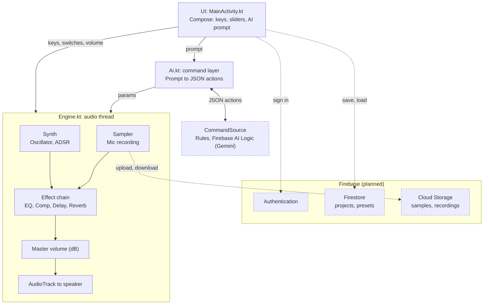

# Архітектура

Додаток складається з інтерфейсу (Compose), аудіорушія (три потоки), AI-шару та запланованих хмарних сервісів Firebase.

## Схема

## Компоненти

| Компонент | Файл | Роль |
|---|---|---|
| UI | `MainActivity.kt` | `Screen` (головний екран), `ScopePanel` (осцилограф, курсор, loop, сітка) |
| Рушій | `Engine.kt` | аудіопотоки, запис, ланцюжок ефектів, master volume, кільцевий буфер осцилографа |
| DSP | `Dsp.kt` | `Synth`, `Sampler`, `Eq`, `Comp`, `Delay`, `Reverb` |
| AI-шар | `Ai.kt` | схема JSON-дій (`Ai.SYSTEM`), виконання дій (`Ai.apply`) |
| Джерела команд | `CommandSource.kt` | `RulesSource`, `FirebaseSource`, `HybridSource` |

Backend: окремого сервера немає. Хмарні функції заплановані через Firebase (див. [decisions.md](decisions.md)).

## Потоки виконання

1. **UI-потік (Compose)** малює екран і обробляє дотики.
2. **`audio-out`** цикл по 256 семплів: обнулення буфера → синтезатор і семплер → ефекти (якщо ввімкнені) → master volume → обрізання до ±1 → запис у `scopeBuf` → `AudioTrack.write`.
3. **`audio-in`** читає `AudioRecord`, збирає шматки в пам'ять; після зупинки нормалізує і передає в `Sampler.load`.
4. **Корутина `Dispatchers.IO`** виконує AI-запит і `Ai.apply`, коли користувач натискає Run.

Потоки обмінюються даними через поля `@Volatile` без блокувань. В аудіопотоці не можна виділяти пам'ять, блокуватися або викликати мережу.

## Потік даних

**Запис і відтворення:** мікрофон → `audio-in` → `Sampler.data` → UI читає той самий масив для малювання; `audio-out` читає його ж під час відтворення.

**Осцилограф Live:** `audio-out` пише вихід у кільцевий буфер (8192 семпли) → `Engine.scope` вирівнює по переходу через нуль → UI малює лінію.

**AI-команда:** текст → `Ai.ask` → `HybridSource` (правила, інакше Gemini) → JSON `{"actions":[...]}` → `Ai.apply` змінює поля ефектів → `audio-out` бачить нові значення на наступному блоці → UI синхронізує перемикачі.

Формат JSON: [ai-component.md](ai-component.md), [api-contract.md](api-contract.md).

## Аудіопараметри

Mono, 44 100 Гц, `PCM_FLOAT`, блок 256 семплів, `PERFORMANCE_MODE_LOW_LATENCY`.
