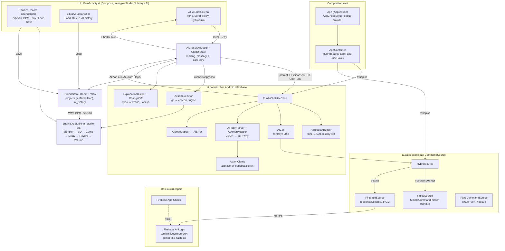

# Архітектура

Додаток складається з інтерфейсу (Compose), аудіорушія (три потоки), AI-сценарію з composition root (`App` / `AppContainer`) та запланованих хмарних сервісів Firebase.

## Схема

Схема відповідає коду на момент Лаби 7: лише компоненти, які реально існують і працюють. Заплановані хмарні
сервіси (Firebase Auth / Firestore / Storage) у коді відсутні, тому зі схеми прибрані (див. [decisions.md](decisions.md)).



## Структура пакетів

Корінь: `app/src/main/java/com/example/soundengitoolkit/`. Тести в `app/src/test/...` повторюють ті самі пакети.

| Пакет | Файли | Що лежить |
|---|---|---|
| (корінь) | `App.kt`, `MainActivity.kt` | точки входу з AndroidManifest |
| `di` | `AppContainer.kt` | composition root |
| `audio` | `Engine.kt`, `Dsp.kt`, `Wav.kt` | рушій, DSP, WAV |
| `data` | `Db.kt`, `Store.kt` | Room і `ProjectStore` |
| `ai.domain` | `Ai.kt`, `AiAction.kt`, `AiError.kt`, `AiErrorMapper.kt`, `CommandSource.kt`, `AiRequest.kt`, `AiCall.kt`, `SimpleCommandParser.kt`, `AiActionMapper.kt`, `AiReplyParser.kt`, `ActionClamp.kt`, `ActionExecutor.kt`, `FxSnapshot.kt`, `ChangeDiff.kt`, `ExplanationBuilder.kt`, `RunAiChatUseCase.kt` | типи, підготовка запиту, таймаут, парсинг, обмеження діапазонів, пояснення, use case; без Android і Firebase |
| `ai.data` | `CommandSources.kt`, `FakeCommandSource.kt` | реалізації `CommandSource` (Rules, Firebase, Hybrid, Fake) |
| `ai.ui` | `AiChatScreen.kt`, `AiChatViewModel.kt`, `ChatUiState.kt` | екран чату, ViewModel, стани і тексти помилок |
| `di` (debug) | `app/src/debug/.../AppCheckSetup.kt` | debug-провайдер App Check; у release — порожня реалізація |
| `ui.library` | `LibraryUi.kt` | діалог збереження, список записів, історія AI |
| `ui.theme` | `Color.kt`, `Theme.kt`, `Type.kt` | тема Compose |

Напрям залежностей: `ai.ui` → `ai.domain` ← `ai.data`; `di` знає всі реалізації. `ai.domain` не імпортує `ai.data`.

## Компоненти

| Компонент | Файл | Роль |
|---|---|---|
| UI | `MainActivity.kt`, `ai/ui/AiChatScreen.kt` | `Screen` (вкладки Studio / Library / AI), `ScopePanel` (осцилограф, курсор, loop, сітка), `AiChatScreen` (чат) |
| Рушій | `audio/Engine.kt` | аудіопотоки, запис, ланцюжок ефектів, master volume, кільцевий буфер осцилографа |
| DSP | `audio/Dsp.kt` | `Sampler`, `Eq`, `Comp`, `Delay`, `Reverb` |
| AI-шар | `ai/domain/Ai.kt` | лише схема дій для моделі (`Ai.SYSTEM`) і тонка обгортка `Ai.apply` (використовується тестами) |
| Use case | `ai/domain/RunAiChatUseCase.kt` | підготовка (`AiRequestBuilder`) → джерело з таймаутом (`AiCall`, 20 с) → парсинг (`AiReplyParser`) → обмеження (`ActionClamp`); повертає `Result<AiPlan>`; не знає `Engine`. `RunAiCommandUseCase` прибрано разом зі старим полем AI command після Лаби 6 |
| ViewModel | `ai/ui/AiChatViewModel.kt`, `ai/ui/ChatUiState.kt` | стани: початковий, Loading, Changed (успіх), NothingChanged (немає результату), Failure (помилка, Retry); `send` ігнорує натискання під час Loading; `retry` замінює бульбашку помилки; дії до `Engine` застосовує колбек екрана (ViewModel не знає `Engine`) |
| Типи AI | `ai/domain/AiAction.kt`, `ai/domain/AiError.kt` | `AiAction` (типізована дія), `AiError` (категорії: InvalidInput, Network, Timeout, Busy, AiUnavailable, InvalidResponse, Unknown), `AiException` |
| Парсинг | `ai/domain/AiActionMapper.kt` | JSON → `List<AiAction>`; чистий парсинг без доступу до `Engine` |
| Виконання | `ai/domain/ActionExecutor.kt` | застосовує `List<AiAction>` до `Engine` тими ж сетерами, що й UI; формує лог |
| Помилки | `ai/domain/AiErrorMapper.kt` | технічний виняток → `AiError`; `CancellationException` не ковтає |
| Джерела команд | `ai/domain/CommandSource.kt`, `ai/data/CommandSources.kt` | інтерфейс `CommandSource` і `CommandReply(json, source)` у домені; реалізації `RulesSource`, `FirebaseSource`, `HybridSource` у `ai.data`; типи Firebase SDK не виходять за межі `FirebaseSource` |
| Fake | `ai/data/FakeCommandSource.kt` | друга реалізація інтерфейсу з режимами SUCCESS, NETWORK_ERROR, UNAVAILABLE, INVALID_JSON; без мережі й ключів |
| Composition root | `App.kt`, `di/AppContainer.kt` | `App` встановлює App Check і створює `AppContainer` один раз; контейнер єдине місце, де обираються реалізації (`useFake`) і збирається `RunAiChatUseCase` |
| Сховище | `data/Store.kt` | `ProjectStore` (збереження, завантаження, видалення, історія AI), `FxState` (ефекти в JSON), `ViewState` (курсор і маркери) |
| База даних | `data/Db.kt` | Room: `ProjectEntity`, `AiEntryEntity`, `ProjectDao`, `AiDao`, `AppDb` |
| WAV | `audio/Wav.kt` | запис WAV 16 біт stereo (L=R), читання mono і stereo |
| UI збереження | `ui/library/LibraryUi.kt` | `SaveDialog`, `ProjectsPanel`, `HistoryPanel` |

Backend: окремого сервера немає. Хмарні функції заплановані через Firebase (див. [decisions.md](decisions.md)).

Інтерфейс має три вкладки (`TabRow`): **Studio** (запис, осцилограф, ефекти, кнопка Save), **Library** (список збережених записів з Load і Delete) і **AI** (чат і AI history; `AiChatScreen` з власним `LazyColumn`, тому рендериться поза прокручуваною колонкою Studio/Library). Старе поле AI command на Studio прибрано після Лаби 6 (тег `lab6-final`). Після Load додаток повертається на Studio. Під час запису перехід на Library заблоковано.

## Рефакторинг сценарію «AI-команда» (лаб. 5): до і після

| | До | Після |
|---|---|---|
| Хто створює джерело | `object Ai`: `var source = HybridSource(RulesSource(), FirebaseSource())` | `AppContainer` (composition root) |
| Хто виконує сценарій | lambda `onClick` у `Screen`: виклик, виконання, текст, історія | `RunAiCommandUseCase` + `ActionExecutor` |
| Формат між шарами | сирий JSON-рядок, `Ai.apply` розбирав його одразу в `Engine` | `CommandReply` → `List<AiAction>` |
| Помилки | рядок `Error: <клас>: <повідомлення>` | `AiError` (5 категорій) |
| Джерело в історії | прихований стан `HybridSource.lastUsed` + приведення типу | поле `CommandReply.source` |
| Часткове застосування | перша дія лишалась застосованою при помилці в другій | парсинг усього до застосування |
| Тестованість | потрібен `Firebase` або мутація глобального `Ai.source` | `FakeCommandSource` через конструктор, тести без мережі |
| Заміна real ↔ fake | неможлива без правки коду | змінюється лише `AppContainer` |
| Стани UI | немає: кнопку Run можна натискати повторно | `AiUiState` (Idle, Loading, Success, Error); Run неактивна під час запиту |
| Повтор після помилки | ввести команду заново | кнопка Retry (розширення, лаб. 5) |

## AI-чат (лаб. 6): компоненти і потік даних

```
AiChatScreen (вкладка AI) ── текст ──► AiChatViewModel ── loading: поле і Send вимкнені
   │  prompt + FxSnapshot.from(engine) + 3 останні ChatTurn
   ▼
[1] ПІДГОТОВКА   AiRequestBuilder → AiRequest(prompt, state, history)
[2] AI           AiCall (таймаут 20 с) → HybridSource
                    ├─ SimpleCommandParser розібрав повністю → RulesSource (офлайн)
                    └─ інакше → FirebaseSource → Gemini (responseSchema)
[3] ПЕРЕТВОРЕННЯ AiReplyParser → ActionClamp → AiPlan
   ▼
AiChatViewModel (main): before = FxSnapshot → ActionExecutor.apply → after = FxSnapshot
   → ExplanationBuilder (ChangeDiff) → ChatAnswer.Changed | NothingChanged → бульбашка в чаті
   → ProjectStore.logAi (source = chat:rules | chat:cloud | chat:error)
Помилка на будь-якому кроці → AiError → ChatMessage.Failure (+ Retry, крім InvalidInput)
```

| Шар | Класи | Тести |
|---|---|---|
| UI | `AiChatScreen`, `ChatUiState`, `ChatMessage` | ручні сценарії, скриншоти |
| Presentation | `AiChatViewModel` | `AiChatViewModelTest` |
| Domain: підготовка | `FxSnapshot`, `AiRequest`, `AiRequestBuilder` | `AiRequestTest` |
| Domain: AI | `AiCall`, `CommandSource`, `SimpleCommandParser` | `RunAiChatUseCaseTest`, `SimpleCommandParserTest` |
| Domain: перетворення | `AiReplyParser`, `ActionClamp`, `ChangeDiff`, `ExplanationBuilder`, `ActionExecutor` | `AiReplyParserTest`, `ActionClampTest`, `ExplanationBuilderTest` |
| Data | `RulesSource`, `FirebaseSource`, `HybridSource`, `FakeCommandSource` | `Lab6ExamplesTest`, `BaselineAiTest` |

`FxSnapshot` (знімок для AI) і `data.FxState` (серіалізація ефектів у Room) — різні класи.
БД не змінювалась; фонових задач немає. Специфікація: [ai-chat.md](ai-chat.md).

## Шлях даних основного сценарію (Лаба 7, за кодом)

Простежено за кодом (commit `0009fbf`, ver 0.2.4) від натискання Send до подальшої дії користувача.

| # | Крок | Файл / клас, функція | Перевірка і обробка помилок | Таймаут |
|---|---|---|---|---|
| 1 | Введення запиту | `AiChatScreen`: `OutlinedTextField` + Send | Send неактивна, якщо поле порожнє або йде запит | — |
| 2 | Передача у ViewModel | `MainActivity.Screen` → `AiChatViewModel.send(text, readFx, applyChat)` | повторний виклик під час `loading` ігнорується; бульбашка запиту додається | — |
| 3 | Підготовка даних | `RunAiChatUseCase.invoke` → `AiRequestBuilder.build`; стан `FxSnapshot.from(engine)`; історія `turns.takeLast(3)` | `trim`; порожній або довший за 500 символів → `AiError.InvalidInput` | — |
| 4 | Маршрутизація | `AiCall.ask` → `HybridSource.ask` → `RulesSource` (`SimpleCommandParser`) | правила розібрали команду повністю → відповідь без хмари (`source = rules`) | 20 с на весь виклик (`withTimeoutOrNull`) → `Timeout` |
| 5 | AI-компонент | `FirebaseSource.ask` → `generateContent(AiRequest.toUserMessage())`, модель `gemini-3.5-flash-lite`, `responseSchema`, `temperature 0.2`, `thinkingLevel LOW` | `IOException` → `Network`; `RequestTimeoutException` → `Timeout`; `ServerException` «high demand» → `Busy`, інша → `AiUnavailable`; виняток з IO-причиною → `Network`; порожня відповідь → `AiUnavailable`. Типи SDK не виходять з класу | 20 с (крок 4); власний таймаут SDK не задано |
| 6 | Обробка відповіді | `AiReplyParser.parse` (`AiActionMapper`) → `ActionClamp.clamp` → `AiPlan` | невалідний JSON → `InvalidResponse`; невідома `fx` → `AiAction.Unknown`, пропускається; поза діапазоном → обрізання + попередження; усе розбирається **до** застосування | — |
| 7 | Застосування | `AiChatViewModel.run` (main) → `before = FxSnapshot` → `applyChat` = `ActionExecutor.apply(engine)` + `sync()` → `after` | виняток → `AiError.Unknown` | — |
| 8 | Пояснення | `ExplanationBuilder.build` + `ChangeDiff.diff(before, after)` | «що змінено» — з фактичного diff, не з тексту моделі; немає змін → `ChatAnswer.NothingChanged` | — |
| 9 | Відображення | `ChatUiState` → `AiChatScreen`: `Answer` / `Failure` + Retry (`canRetry`) | `loading = false` у кожній гілці; тексти помилок — `AiError.chatMessage()`, без класів винятків | — |
| 10 | Історія | `ProjectStore.logAi` → Room `ai_history` (≤ 200) | помилка БД не ламає чат (best-effort) | — |
| 11 | Подальша дія | Studio: Play / Loop A-B → Save → `ProjectStore.save` (WAV + `FxState.toJson` у `effectsJson`); Library → Load → `ProjectStore.load` | порожній запис → «Nothing to save: record something first»; запис через `.tmp` + перейменування | — |

### Конфігурація зовнішнього AI-сервісу

| Що | Фактично в коді / проєкті |
|---|---|
| Сервіс | Firebase AI Logic, Gemini Developer API (`GenerativeBackend.googleAI()`), виклик з клієнта, власного backend немає |
| Конфігурація | `app/google-services.json` — у `.gitignore`, у репозиторій не потрапляє; ключів у коді немає |
| Ініціалізація | `FirebaseSource.model` — `lazy`: без `google-services.json` застосунок запускається, хмарний запит дає `AiUnavailable` |
| App Check | `AppCheckSetup` лише в `src/debug` (debug provider); debug token кожного пристрою реєструється в консолі, без нього — `AiUnavailable` («Cloud AI is unavailable…»). У release провайдера немає → для демонстрації лише debug APK |
| Тариф | Spark (безкоштовний), модель не потребує білінгу |
| Таймаут | 20 с (`AiCall.TIMEOUT_MS`), автоматичних повторів немає, Retry вручну |
| Мережа | `INTERNET` у маніфесті; HTTPS, Network Security Config не потрібен (локального backend немає) |

### Слабкі місця, знайдені під час трасування

| ID | Де | Що | Що робимо |
|---|---|---|---|
| W-1 | `AiChatViewModel.fail`, `FirebaseSource` | Оригінальний виняток не пишеться в Logcat ніде (`Log` у `main` не використовується): користувач бачить зрозумілий текст, але причину збою на демонстрації не видно | **Виправлено** (Лаба 7): `AiChatViewModel` отримує `logError`, `MainActivity` передає `Log.w("AiChat", …, cause)`; тест `failure_originalExceptionLogged_notShownToUser` |
| W-2 | `AiRequestBuilder` + `AiError.userMessage` | Запит довший за 500 символів дає повідомлення «Enter a command first» — неправильне пояснення; поле введення довжину не обмежує | **Виправлено** (Лаба 7): поле обрізає введення до 500 символів і показує лічильник; текст `InvalidInput` — «Enter a command (up to 500 characters)» |
| W-3 | `MainActivity` (`private val engine = Engine()`) | L-13 / L-23: поворот екрана створює новий `Engine` — скидаються запис і ефекти, а відповідь AI, що прийшла під час повороту, застосовується до зупиненого рушія. Чат (ViewModel) при цьому зберігається і показує зміни, яких уже немає | **Виправлено** (Лаба 7): орієнтація зафіксована `portrait` у `AndroidManifest.xml`; інші зміни конфігурації — обмеження L-13 |
| W-4 | `MainActivity` (Save / Load / Delete) | Помилки показуються як `"Save failed: ${ex.message}"` — сирий текст винятку | **Виправлено** (Лаба 7): зрозумілі тексти, оригінал — `Log.w("Library", …)`; `CancellationException` не перехоплюється |
| W-5 | `ChatUiState.canRetry` | `AiUnavailable` (налаштування, App Check) пропонує Retry, хоча повтор не допоможе, доки не виправлено конфігурацію | Залишити (ручний Retry без автоповторів, за специфікацією), описати в README |

## Потоки виконання

1. **UI-потік (Compose)** малює екран і обробляє дотики.
2. **`audio-out`** цикл по 256 семплів: обнулення буфера → синтезатор і семплер → ефекти (якщо ввімкнені) → master volume → обрізання до ±1 → запис у `scopeBuf` → `AudioTrack.write`.
3. **`audio-in`** читає `AudioRecord`, збирає шматки в пам'ять; після зупинки нормалізує і передає в `Sampler.load`.
4. **Корутина** (`viewModelScope` в `AiChatViewModel`) виконує `RunAiChatUseCase`, коли користувач натискає Send або Retry (мережевий виклик suspend і не блокує UI-потік), а також усі операції з файлами та базою (`ProjectStore`, `Dispatchers.IO`).

Потоки обмінюються даними через поля `@Volatile` без блокувань. В аудіопотоці не можна виділяти пам'ять, блокуватися або викликати мережу.

## Потік даних

**Запис і відтворення:** мікрофон → `audio-in` → `Sampler.data` → UI читає той самий масив для малювання; `audio-out` читає його ж під час відтворення.

**Осцилограф:** показує весь запис (`Sampler.data`) з курсором, loop-маркерами й сіткою бітів. Режим Live прибрано з UI після Лаби 6; `audio-out` і далі пише вихід у кільцевий буфер, а `Engine.scope`/`levels` лишились у коді без використання (D-12).

**AI-чат:** див. розділ «AI-чат (лаб. 6): компоненти і потік даних» вище. До прибрання старого поля AI command його сценарій ішов через `AiCommandViewModel` → `RunAiCommandUseCase` → той самий `HybridSource` (тег `lab6-final`).

**Збереження:** Save → `ProjectStore.save` (IO): `sampler.data` → WAV `filesDir/projects/<uuid>.wav` (спершу `.tmp`, потім перейменування) → запис у Room з BPM, курсором, маркерами та JSON ефектів. Load → читання WAV → `e.bpm`, `FxState.apply`, `sampler.load` → `ScopePanel` бачить новий масив і відновлює курсор та маркери зі `ViewState`. Зберігається сухий запис, а не результат з ефектами.

**Історія AI:** після кожного Run `ProjectStore.logAi` пише запит, JSON, журнал і джерело (`rules`, `cloud`, `fake`, `error`; для чату `chat:rules`, `chat:cloud`, `chat:error`; до Лаби 6 також `rules (cloud failed)`) у Room; зберігається до 200 записів.

Формат JSON: [ai-component.md](ai-component.md), [api-contract.md](api-contract.md).

## Аудіопараметри

Mono, 44 100 Гц, `PCM_FLOAT`, блок 256 семплів, `PERFORMANCE_MODE_LOW_LATENCY`.
